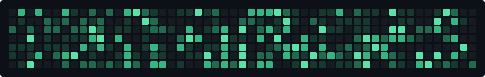

<div align="center">




<br/>


<a href="https://git.io/typing-svg">
  
</a>

<br/>


<a href="mailto:kiranmadhav.in@gmail.com"></a>
<a href="https://linkedin.com/in/kiran--madhav"></a>
<a href="https://yourwebsite.com"></a>
<a href="https://x.com/kiran__madhav"></a>

<br/><br/>


</div>

### `kiran@madhav:~$` whoami

```console
Kiran Madhav
├── role        Full-Stack Developer
├── studying    Computer Science
├── focus       clean architecture · small sharp tools · quiet interfaces
├── interests   AI · Full Stack · Cybersecurity
├── currently   building and learning new things
└── motto       "Pixel meets logic."
```

### `kiran@madhav:~$` cat ~/.stack

<div align="center">



<br/><br/>


</div>

### `kiran@madhav:~$` git log --stat

<div align="center">


&nbsp;


<br/><br/>


<br/><br/>


<br/>




<br/><br/>


</div>

<br/>

<div align="center">




<br/>

<a href="https://www.buymeacoffee.com/kiranmadhav">
  
</a>

<br/><br/>


</div>

